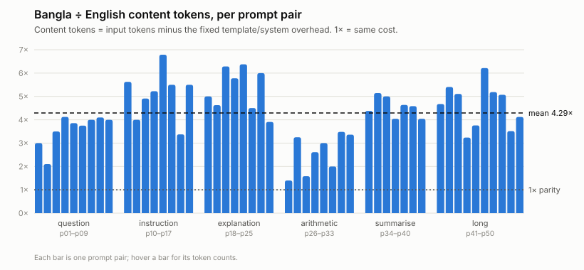

# English vs Bangla Token Cost: report

Agentic Software Engineering, Part 1, Assignment 2.
Model: **`qwen2.5:3b`** (Ollama id `357c53fb659c`), Ollama 0.40.16. Prices are the course's
notional ones: $0.15 per million input tokens and $0.60 per million output tokens.

## 1. Setup

- **Dataset.** `data/dataset.csv` has 50 aligned pairs in 6 categories:
  - question: 9
  - instruction: 8
  - explanation: 8
  - arithmetic: 8
  - summarise: 7
  - long, 3–5 sentences: 10

  English prompts range from 5 words ("What is 17 + 25?") to 48 words. The Bangla was
  written directly (no translation tool) with Bangla digits, and **must be reviewed pair by
  pair by a Bangla speaker** (see `AI_LOG.md`).
- **Same settings for both languages:**
  - temperature 0, seed 42;
  - max output 512 tokens (`num_predict`);
  - `num_ctx` 4096;
  - one fixed system prompt, "You are a helpful assistant. Answer clearly and concisely.",
    with no instruction about which language to answer in.

  English and Bangla calls alternate which goes first from pair to pair. A warm-up call
  loads the model before any timed call.
- **Token counts are Ollama's own:** `prompt_eval_count` (input) and `eval_count` (output).
- **Template overhead.** An empty user message costs **26 input tokens**: Qwen's chat
  template plus the system prompt. *Content tokens* are input tokens minus 26. Input tokens
  are what you pay for; content tokens isolate the tokenizer.
- **Prompt caching.** After the run, all 100 prompts were counted again, in reverse order.
  **0 of 100 counts changed**: in this Ollama version, caching makes repeat calls faster but
  does not shrink `prompt_eval_count`.

## 2. Measures

| Measure | English | Bangla | Bangla ÷ English |
|---|---|---|---|
| Input tokens, total (50 prompts) | 2,310 | 5,676 | **2.46** |
| Content tokens, total (input − 26 per call) | 1,010 | 4,376 | **4.33** |
| Output tokens, total | 2,938 | 10,145* | 3.45 |
| Input cost (USD) | 0.000346 | 0.000851 | **2.46** (input cost ratio) |
| Total cost (USD) | 0.002109 | 0.006938 | **3.29** (total cost ratio) |
| Latency per call, mean / median (s) | 9.09 / 4.95 | 27.20 / 18.79 | 2.99 / 3.80 |
| Answers cut off at 512 tokens | 0 | 6 | |

\*6 Bangla answers hit the 512-token limit (p08, p09, p21, p22, p43, p47), so the Bangla output
total is a lower bound. Not one English answer was cut off.

**Spread of the per-pair ratio** (50 pairs; 95% bootstrap interval of the mean, 10,000
resamples):

| Per-pair ratio | mean | median | min | max | 95% CI of mean |
|---|---|---|---|---|---|
| Input tokens | 2.29 | 2.14 | 1.11 (p26) | 4.22 (p46) | 2.10 – 2.48 |
| Content tokens | 4.29 | 4.12 | 1.40 (p26) | 6.79 (p14) | 3.96 – 4.62 |
| Output tokens | 5.20 | 4.00 | 1.07 (p28) | 18.08 (p13) | 4.24 – 6.24 |
| Total cost | 4.05 | 3.37 | 1.12 (p28) | 13.93 (p13) | 3.42 – 4.75 |

Per-pair values for all 50 pairs are in `results/qwen2.5-3b/comparison.csv`. Every call
(prompt, output, tokens, cost, latency) is in `results.csv` / `results.jsonl`.

There are two ways to state "the ratio":
- **Ratio of totals: 2.46.** This is what a bill would show.
- **Mean of per-pair ratios: 2.29.** This is what a typical prompt sees.

They differ because long prompts weigh more in the totals.

## 3. Chart and categories

| Category | pairs | content ratio (mean) | input ratio (mean) | total cost ratio (mean) |
|---|---|---|---|---|
| explanation | 8 | **5.31** | 2.11 | 4.69 |
| instruction | 8 | **5.11** | 2.22 | **5.76** |
| long | 10 | 4.63 | **3.31** | 3.46 |
| summarise | 7 | 4.55 | 2.67 | 3.57 |
| question | 9 | 3.60 | 1.68 | 3.54 |
| arithmetic | 8 | 2.59 | 1.59 | 3.43 |

- **Largest gap:** explanation and instruction prompts have the largest tokenizer gap. They
  are pure prose with no digits or names, and Bangla words split into many pieces.
  Instruction prompts also have the largest *cost* gap, because the Bangla answers ran much
  longer (p13, p11, p12).
- **Smallest gap:** arithmetic, because digits and symbols make up much of the prompt.
- **Overhead dilution:** for short prompts the fixed 26-token overhead dilutes the input
  ratio. Questions have a 3.60× content gap but only 1.68× on the bill. Long prompts show the
  largest billed input gap (3.31×) because their content outweighs the overhead.

## 4. A surprising case: p26, "What is 17 + 25?" / "১৭ + ২৫ কত?"

**What surprised me:** the lowest content ratio of all, 1.40 (10 vs 14 tokens). I expected
Bangla digits to be the cheap part. A direct probe showed the opposite: each Bangla digit
costs **2 tokens** and a Latin digit costs 1 (`১২৩৪৫৬৭` = 14 tokens vs `1234567` = 7).

**Why the ratio is still low anyway:**
- The one Bangla word, "কত", costs 2 tokens, the same as "What is".
- The prompt is too short for Bangla's per-word penalty to build up.

**The bill still shows a gap:**
- The total cost ratio for p26 is 2.65.
- The Bangla answer was correct (৪২) but added an English sentence explaining the "Bengali
  numeral system".
- The output-side gap is often larger than the input-side one.

**The other extreme is p13** ("two tips for saving electricity"): a total cost ratio of
**13.9**. The English answer was 25 tokens. The Bangla answer was 452 tokens of one
phrase repeated ("বিদ্যুৎ সাশ্রয়ের পরিকল্পনা…"), in a loop with no useful tip.

## 5. Quality check (10 pairs)

I chose these pairs to cover every category. The verdicts were checked against the actual
outputs in `results.jsonl`.

| Pair | English answer | Bangla answer | Bangla as good? |
|---|---|---|---|
| p02 leap-year days | 366: correct | "365 দিন" + garbled condition: wrong | No |
| p04 closest planet | Mercury: correct | "ভূগ্রহ (Earth)": wrong | No |
| p11 three vitamin-C fruits | orange, kiwi, grapefruit | invented names ("কুচি", "কুচি গুড়ি"…) | No |
| p16 past tense | "I went to school by bus." | "আগে বাসে করে স্কুলে যাই": still present tense | No |
| p19 why the sky is blue | Rayleigh scattering: correct | about rain water mixing with the sky: wrong | No |
| p26 17 + 25 | 42 | ৪২ (+ an English note) | Yes |
| p29 7 pens at 12 taka | 84 | 84 | Yes |
| p36 summarise library | correct | correct, but drops "free" (বিনামূল্যে) | Yes, minor loss |
| p44 tea-shop income | sets up 420 vs 400 correctly, then says "down by 20" (it goes **up**) | 480 / 350: wrong | Both wrong |
| p49 marks and scholarship | says Physics 64 < 40 failed (wrong); average 73.67, no scholarship (right) | passed all (right); average "75.33" and scholarship (wrong) | Both half wrong |

**Score:** English is fully correct on 8 of 10 pairs, Bangla on 3. In the 5 pairs where
English was right and Bangla wrong, the Bangla answer was confidently wrong, not a refusal.

**Answer language:** in 45 of 50 Bangla prompts the answer was mostly in Bangla. In 5 it was
mostly English (p01, p17, p26, p28, p37). In p01 the model also leaked a Chinese character
(东京) and invented a capital "relocation".

## 6. Conclusions

1. **Input cost:** on `qwen2.5:3b`, the same meaning in Bangla costs **2.46× the input
   tokens** on the bill. On content alone it is **4.33×** (95% CI of the per-pair mean:
   3.96–4.62×). The template overhead hides part of the gap on short prompts.
2. **Total cost:** **3.29×**, because Bangla answers are also longer: 3.45× the output tokens,
   and 6 hit the cap. Some are long only because the model loops or pads.
3. **Latency:** Bangla calls take about **3× longer**. Most of that is the extra output, not
   the input.
4. **Quality:** the extra money and time buy **worse answers**. In the 10-pair check,
   Bangla was right in 3 of 10 and English in 8 of 10. Bangla users of this model pay more
   for less.
5. **What did not work, or is uncertain:**
   - The output ratios depend on the 512-token cap and on the model looping.
   - The Bangla wording and the quality verdicts still need review by a native speaker.
   - This is one model at temperature 0: input counts are deterministic (confirmed by the
     re-count), and the output side would vary at other settings.
   - The Qwen 2.5 7B model uses the same tokenizer, so a tokenizer comparison (the bonus)
     needs a different model family.

## Reproduce

`python -m unittest` (30 offline tests), then `python -m tokencost.runner`. See `README.md`.
AI-assistant use is logged in `AI_LOG.md`.
